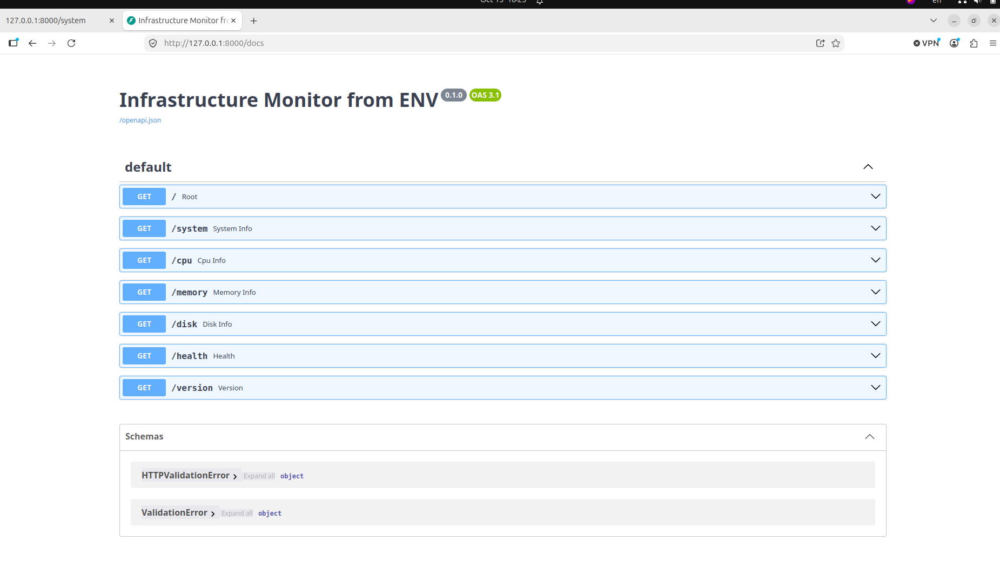
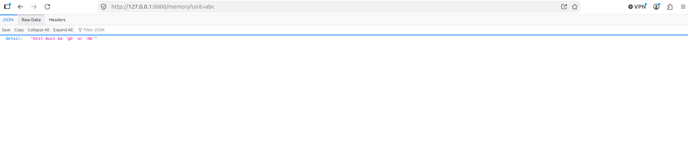
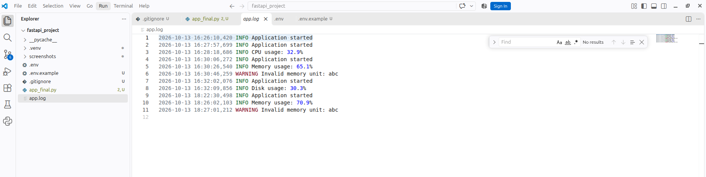
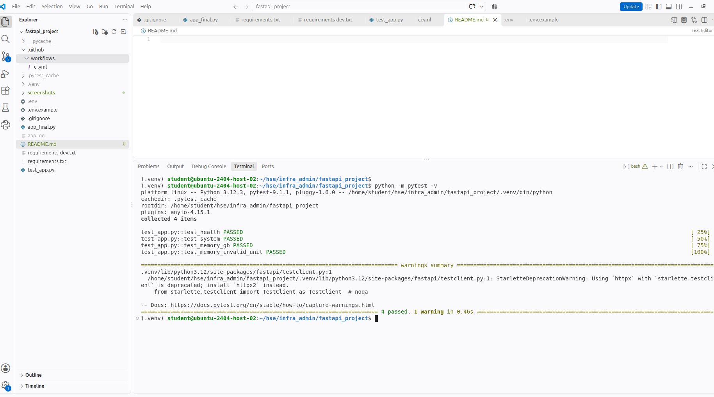
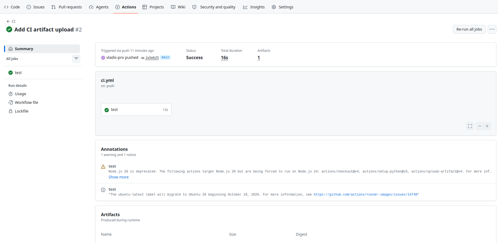

# Infrastructure Host Monitor API

Выполнил: VO

Учебный проект по курсу «Инфраструктура и администрирование».

Приложение написано на FastAPI и показывает основные параметры компьютера, на котором оно запущено: информацию о системе, загрузку процессора, использование оперативной памяти и диска.

## Возможности

Доступны следующие маршруты:

- `/` — проверка запуска приложения
- `/system` — имя компьютера и операционная система
- `/cpu` — текущая загрузка процессора
- `/memory` — использование оперативной памяти
- `/disk` — использование диска
- `/health` — проверка работоспособности приложения
- `/version` — версия приложения
- `/docs` — автоматически созданная документация FastAPI

Маршрут `/memory` принимает параметр `unit`.

Примеры:

```text
/memory?unit=gb
/memory?unit=mb
```

Если указать другое значение, приложение возвращает ошибку HTTP 400.

## Установка

Клонировать репозиторий:

```bash
git clone https://github.com/vladis-pro/hse_fastapi_project.git
cd hse_fastapi_project
```

Создать виртуальное окружение:

```bash
python3 -m venv .venv
```

Активировать виртуальное окружение в Linux/macOS:

```bash
source .venv/bin/activate
```

Установить зависимости приложения:

```bash
pip install -r requirements.txt
```

## Переменная окружения

Приложение использует переменную окружения:

```text
APP_NAME
```

Пример настройки находится в файле:

```text
.env.example
```

Для локального запуска можно создать файл `.env`:

```bash
cp .env.example .env
```

Если переменная `APP_NAME` не задана, используется стандартное название:

```text
Infrastructure Host Monitor API
```

Файл `.env` не добавляется в Git-репозиторий.

## Запуск приложения

Для разработки:

```bash
uvicorn app_final:app --reload
```

После запуска документация FastAPI доступна по адресу:

```text
http://127.0.0.1:8000/docs
```

Для обычного запуска без автоматической перезагрузки:

```bash
uvicorn app_final:app
```

## Проверка health и version

Проверка работоспособности:

```text
http://127.0.0.1:8000/health
```

Ожидаемый ответ:

```json
{"status":"ok"}
```

Проверка версии:

```text
http://127.0.0.1:8000/version
```

Ожидаемый ответ:

```json
{"version":"1.0.0"}
```

## Тесты

Для установки зависимостей приложения и тестов:

```bash
pip install -r requirements-dev.txt
```

Запуск тестов:

```bash
python -m pytest -v
```

В проекте проверяются:

- `/health`
- `/system`
- `/memory?unit=gb`
- ошибка при неправильном параметре `/memory?unit=abc`

## Логи и диагностика

Во время работы приложение создаёт файл:

```text
app.log
```

В лог записываются:

- запуск приложения
- загрузка CPU
- использование памяти
- использование диска
- неправильное значение параметра памяти

Файл `app.log` не добавляется в Git-репозиторий.

Для диагностики можно:

1. проверить `/health`;
2. проверить `/version`;
3. посмотреть `app.log`;
4. запустить тесты командой `python -m pytest -v`.

## GitHub Actions

Для проекта настроен GitHub Actions CI.

При `push` и `pull request` GitHub автоматически:

1. получает код проекта;
2. запускает временную Ubuntu-машину;
3. устанавливает Python 3.12;
4. устанавливает зависимости;
5. запускает тесты;
6. после успешных тестов создаёт artifact `application-files`.

## Скриншоты

### Документация FastAPI



### Использование оперативной памяти


### Обработка неправильного параметра



### Логи приложения



### Автоматические тесты



### GitHub Actions и artifact

